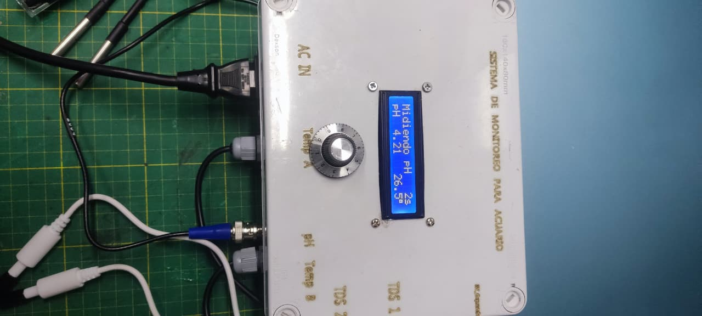
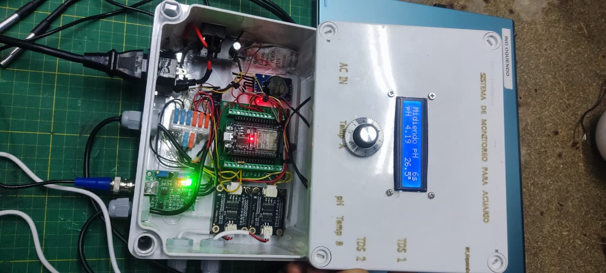

# ESP32 Aquarium Monitor

A standalone monitor for freshwater aquariums. It measures temperature and total dissolved solids (TDS) continuously, and pH on demand, with guided calibration from a rotary-encoder menu. No Wi-Fi or computer needed.

| Front panel | Inside |
| --- | --- |
|  |  |

Built as a commissioned project for a university lab. The front panel was laser-engraved at the Exploratorio of Parque Explora (Medellín, Colombia).

> Code comments, the calibration guide and the on-screen text are in Spanish.

## Features

- **2 temperature probes** (DS18B20), read by their ROM address so they never swap.
- **2 TDS probes**, temperature-compensated to 25 °C.
- **pH on demand**: one click turns the TDS probes off, waits for a stable reading and shows the result with the time.
- **Guided calibration**: pH with 2 or 3 buffers (with buffer-temperature tables), and TDS against a 1413 µS/cm standard. A point is only accepted once the reading is stable.
- Calibrations are stored in the ESP32 flash and survive power loss; a DS3231 RTC tracks how old each calibration is.
- Powered from 120 V AC through an isolated HLK-PM01 module.

## Hardware

| Part | Role | Interface |
| --- | --- | --- |
| ESP32 DevKit (30 pins) | Controller | — |
| 2 × DS18B20 waterproof probes | Temperature | OneWire, GPIO 4 |
| pH module PH0-14 + BNC probe | pH | Analog → ADS1115 A0 (through a 10k/20k divider) |
| 2 × analog TDS modules (Gravity SEN0244 type) | TDS | Analog → ADS1115 A1 / A2 |
| ADS1115 | 16-bit ADC for pH and TDS | I2C 0x48 |
| LCD 16×2 + PCF8574 backpack | Display | I2C 0x27 |
| DS3231 RTC + CR2032 | Calibration dates | I2C 0x68 |
| EC11 rotary encoder with push button | Menu | GPIO 25, 26, 27 |
| HLK-PM01 | 120 V AC → 5 V DC | — |

| Function | Pin |
| --- | --- |
| I2C SDA / SCL | GPIO 21 / 22 |
| TDS 1 / TDS 2 power | GPIO 32 / 33 |

## Design decisions

- **ADS1115 instead of the ESP32 ADC.** The internal ADC is non-linear and tied to the 3.3 V rail. The ADS1115 has its own reference and 0.125 mV resolution; its measured linearity error was 0.4 %.
- **Voltage divider on the pH output.** The pH module runs at 5 V and its output can reach 5 V; a 10k/20k divider keeps it under the ADS1115's 3.6 V limit.
- **Mains-synchronous averaging.** The pH electrode has a very high impedance and picks up 60 Hz noise. Each reading averages 32 samples at 128 SPS: 250 ms, exactly 15 mains cycles, so the noise cancels out.
- **TDS probes powered from GPIOs.** Their excitation current disturbs the pH electrode, so the firmware switches them off before every pH reading.
- **Piecewise pH calibration with Nernst compensation.** One line per segment (pH 4–7 and 7–10), with the slope scaled by absolute temperature.
- **Non-blocking measurements.** A state machine takes short steps, so the encoder and display stay responsive while the sensors are read.

## Calibration results

| Measurement | Result |
| --- | --- |
| pH electrode slope (buffers 4 and 7) | 176.8 mV/pH, 100 % of theoretical (Nernst × module gain) |
| pH linearity check with a third buffer | 0.03 pH error at pH 10 |
| Electrode time constant | 28 s (pH 4), 36 s (pH 10) |
| Temperature probes in the same water | 0.05 °C apart, less than one LSB |
| ADS1115 offset | 0.1 mV |

Raw pH calibration logs are in [`datos/`](datos/).

## What I learned

- **Measure before replacing parts.** Twice the pH "stopped working"; both times the probe was fine and the fault was a loose wire on the ADC input, which reads a fixed 0.87 V when floating.
- **A voltage that follows the supply means an open ground.** A TDS module with a loose GND read 2.9 V in air.
- **Probe placement matters for conductivity.** Depth, container size and a second probe in the same water all change the reading, so calibration and measurement must use the same setup.
- **Check your "distilled" water.** A bag of saline solution saturated the TDS sensor; the sensor itself revealed the mistake.

## Repository

```
firmware/
  monitor_acuarios/   Main firmware (v1.2)
  00_… to 05_…        Step-by-step hardware tests used during the build
  herramientas/       Python scripts for the serial port (read, send commands, set the RTC)
docs/
  GUIA_CALIBRACION.md Calibration guide (Spanish)
datos/                Raw pH calibration logs
images/               Photos
```

## Build

- Arduino IDE 2 or `arduino-cli`, with the **esp32 by Espressif** core (tested with 3.3.2). Board: *ESP32 Dev Module*.
- Libraries: OneWire, DallasTemperature, Adafruit ADS1X15, RTClib, LiquidCrystal_I2C (Frank de Brabander).

```
arduino-cli compile --upload --fqbn esp32:esp32:esp32 -p COM4 firmware/monitor_acuarios
```

Before using the main firmware, set your own DS18B20 ROM addresses and factory pH values in `firmware/monitor_acuarios/config.h`.

## Safety

This device is connected to mains voltage. Keep the 120 V section in insulated screw terminals with a fuse on the line conductor, never on a breadboard. Do not connect USB while the AC supply powers the board.

## License

[MIT](LICENSE)
